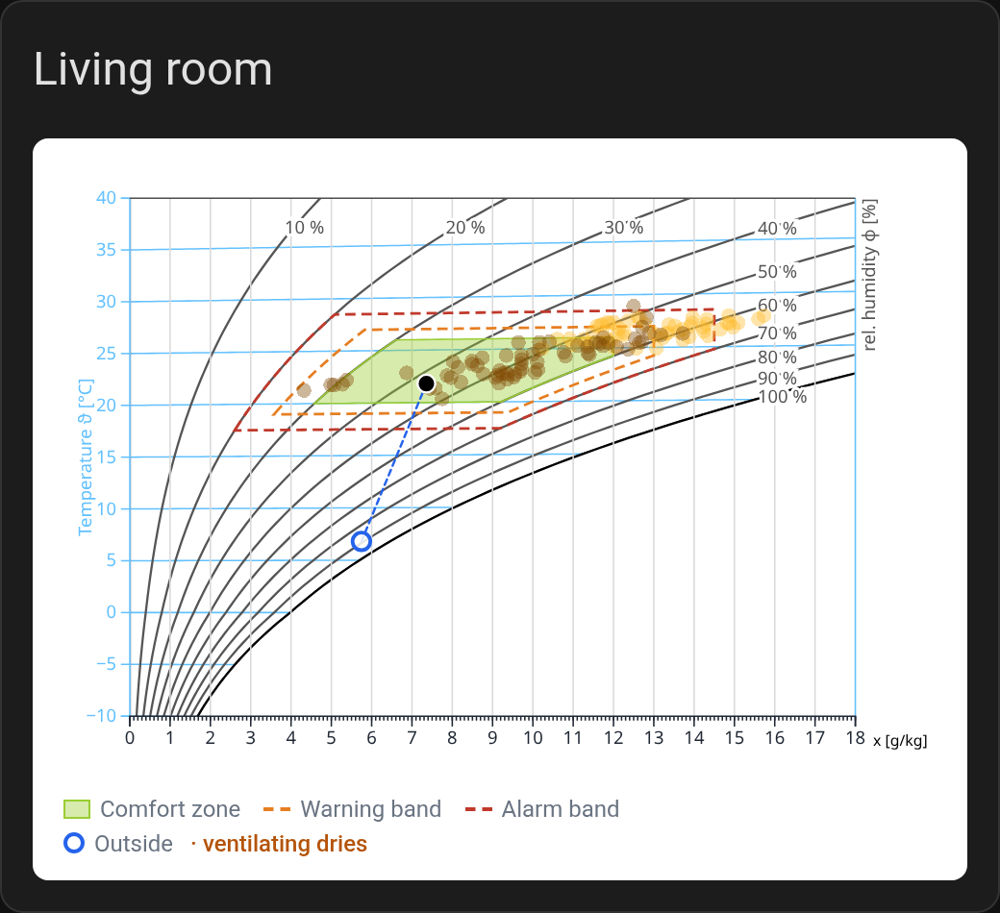
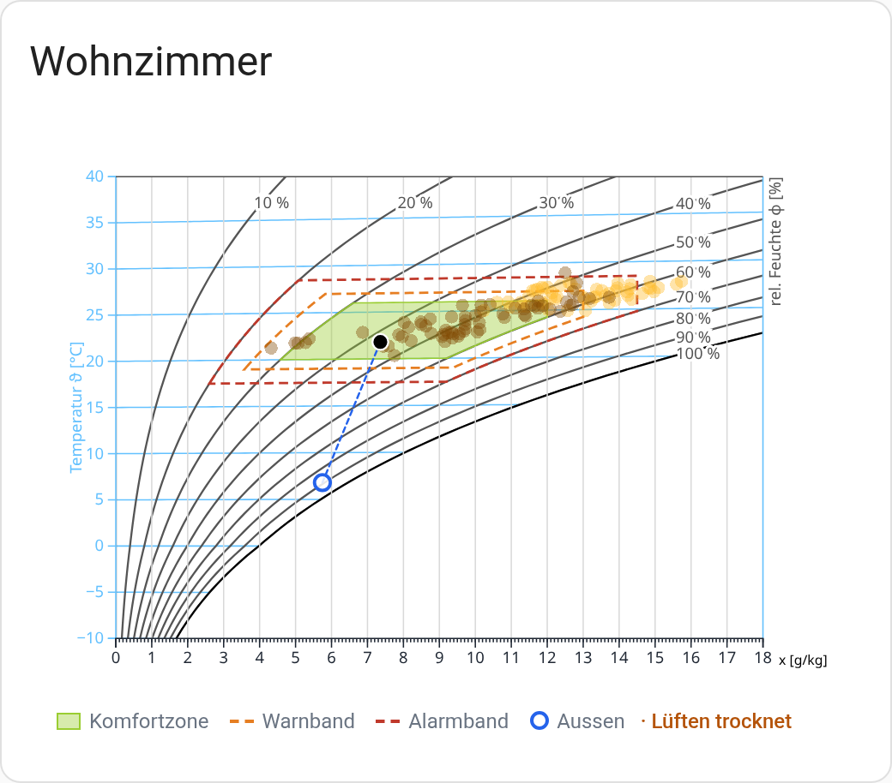

<p align="center">
  
</p>

<p align="center">
  <a href="https://github.com/retomarek/mollier-hx-card/releases"></a>
  <a href="https://github.com/hacs/integration"></a>
  
  <a href="https://github.com/retomarek/mollier-hx-card/actions/workflows/validate.yaml"></a>
  <a href="https://github.com/retomarek/mollier-hx-card/releases"></a>
  <a href="LICENSE"></a>
</p>

<p align="center">
  <a href="https://my.home-assistant.io/redirect/hacs_repository/?owner=retomarek&repository=mollier-hx-card&category=plugin"></a>
</p>

> **Sister card: [Comfort Compass Card](https://github.com/retomarek/comfort-compass-card).** Uses the same comfort zone and warning bands and sums up how many days were in range, too warm, too humid, too dry or too cold. The diagram shows *where* each day was, the compass *how often*.

<p align="center">
  
  
</p>

Plot your room climate where it belongs: on a Mollier h,x diagram. The card reads the daily means of a temperature and a humidity sensor from Home Assistant's long-term statistics and plots one point per day. Draw your comfort zone and add orange and red warning bands around it.

> **Built on [pyedautils](https://github.com/retomarek/pyedautils)**, the *Python Energy Data Analysis Utilities*: a pip-installable library (`pip install pyedautils`) for analysing and visualising energy and comfort time series. The card draws the same diagram as its `plot_mollier_hx()`, so you can take the same sensor data into Python or Jupyter for deeper analysis.

## Why temperature and humidity belong together

Comfort, health and the risk of mould always depend on temperature **and** humidity at the same time. Looking at one of them alone, or at two separate graphs, can easily mislead:

- **Relative humidity changes with temperature.** Air at 21 °C and 60 % holds about 9.3 g of water per kg. Warm the same air to 26 °C and it reads only 44 %; cool it at a 15 °C outer wall and it reaches about 87 %, enough for mould. The amount of water did not change at all.
- **The same reading means different things.** 23 °C feels pleasant at 45 %, but sticky at 70 %.

The h,x diagram shows both in one point: its position gives temperature, relative and absolute humidity at once, and how far each day was from the comfort zone.

## The h,x diagram in five minutes

The [Mollier h,x diagram](https://en.wikipedia.org/wiki/Psychrometrics#Mollier_diagram) is the map engineers use for moist air; in English-speaking countries the same physics is usually drawn as the psychrometric chart, rotated and mirrored. Every state of the air is one point:

- **Up and down** is the temperature (°C).
- **Left and right** is the absolute humidity *x*, the grams of water in one kilogram of dry air. Left is dry, right is humid.
- **The curved lines** are the relative humidity φ. The bottom curve, 100 %, is saturation: air cannot hold more water. Cool air down to this curve and water condenses, on windows, cold walls or as fog. That temperature is the **dew point** (see below).
- The pressure (from your altitude) shifts the curves a little; the card takes it into account.

How processes move the point:

- **Heating or cooling** without adding or removing water moves the point straight **up or down**: *x* stays the same, only the relative humidity changes. Heating makes air relatively drier, cooling relatively more humid.
- **Adding moisture** (people, showering, cooking, plants, a humidifier) moves it to the **right**. **Removing moisture** (ventilating with dry air, a dehumidifier) moves it to the **left**.
- **Mixing** two airs, for example room air and outside air when you ventilate, puts the result on the straight line between the two points.

### Dew point: where condensation and mould start

To find the dew point of the room air, go **straight down** from the point to the 100 % curve: the temperature there is the dew point. Any surface colder than that gets wet: the inside of single glazing, window frames, thermal bridges, outside corners, walls behind wardrobes.

Mould does not even need visible water. It starts to grow when the air right at a surface stays above about **80 % relative humidity** for a while, which happens a few degrees **above** the dew point:

| Room air | Water content | Dew point (condensation) | Mould risk at surfaces below |
| --- | --- | --- | --- |
| 20 °C, 40 % | 6.1 g/kg | 6.0 °C | 9.3 °C |
| 21 °C, 50 % | 8.1 g/kg | 10.2 °C | 13.6 °C |
| 21 °C, 60 % | 9.8 g/kg | 12.9 °C | 16.4 °C |

On a cold winter day, the inside of an outside wall corner or an old window frame can easily be 12–15 °C. At 21 °C and 60 % that is already critical; at 21 °C and 50 % it is borderline; at 40 % it is safe. This is why it pays to give the comfort zone an absolute-humidity limit (12 g/kg in the examples) and to watch days near the right-hand edge of the zone.

### Example: ventilating in winter makes the room drier

Cold outside air holds little water. At 0 °C and 80 % it carries about 3.2 g/kg. Heated to 21 °C in the room, the same air has only about **20 %** relative humidity, because warm air could hold far more. Ventilating therefore moves the room point to the left: the room gets drier. That is why rooms are often too dry in winter, and why airing out works so well against too much humidity. Short, wide-open airing (a few minutes, cross-draught) exchanges the humid air without cooling the walls.

### Example: heating less raises the humidity, and saves energy

Turn the heating down and the point moves straight down: the water content stays, the relative humidity rises. Room air with 6.4 g/kg reads about **35 %** at 23 °C, **40 %** at 21 °C and **42 %** at 20 °C. Relative humidity between about 40 and 60 % is pleasant for most people and easier on eyes and airways; viruses and dust mites also do worse in that range than in very dry or very humid air.

It also helps the environment: as a rule of thumb, every degree less saves around **6 % of heating energy**. A slightly cooler room with comfortable humidity often feels better than a warm, dry one, with a smaller energy bill and lower emissions.

The limit is on the other side: if the relative humidity at cold surfaces (outside walls, window frames, corners behind furniture) climbs above about 80 %, mould can grow. The comfort zone and the warning bands on the card help to stay in between.

### Example: airing a cool cellar in summer can make it damp

Warm summer air carries a lot of water: at 25 °C and 70 % about 14.7 g/kg. Let it into a cellar at 18 °C and it cools below its dew point (about 19 °C): water condenses on the walls. In summer, air a cool cellar in the early morning or at night, when the outside air holds less water. The diagram shows it at a glance: is the outside point to the left of the room point?

## Features

- **h,x diagram** for your altitude or air pressure. Choose which iso-lines to show: temperature, relative and absolute humidity, density, enthalpy.
- **One point per day** from the recorder's long-term statistics, coloured by season, by age or connected in time order, plus a live point for the current reading.
- **Comfort zone** as a polygon from temperature, relative and absolute humidity limits.
- **Warning bands**: orange and red dashed bands as ± offsets around the comfort zone.
- **Outside air** (optional): the current outside point, the outside daily means and a ventilation line to the room point. The legend tells you whether airing dries the room or adds moisture.
- **Fits any dashboard**: fills a sections tile with a fixed height, keeps its aspect ratio (capped and centred) everywhere else, so it also looks right at full width.
- **Visual editor** with entity pickers limited to sensors that have long-term statistics.
- **Translated** into 14 languages, following your Home Assistant language. Corrections welcome, see [Translations](#translations).
- **Self-contained**: one JavaScript file, no external requests at runtime.

## Requirements

Both sensors need long-term statistics, which means `state_class: measurement`. Most temperature and humidity sensors already have it (Zigbee, Z-Wave, ESPHome, Netatmo, AirGradient and many more). The visual editor only lists sensors that qualify.

## Installation

From Home Assistant 2026.11 on, community cards come from the built-in **Marketplace** (*Settings → Marketplace*). On older versions use **HACS**. Both use the same catalog.

1. Open the link above, or search for **Mollier hx Card**.
   - Not listed yet? Marketplace: *Add from link* with `https://github.com/retomarek/mollier-hx-card`. HACS: three-dot menu → *Custom repositories*, type *Dashboard*.
2. Install it. The dashboard resource is added for you.
3. Reload the browser.

## Configuration

Add a card, pick **Mollier hx card** and fill in the form. Or use YAML:

```yaml
type: custom:mollier-hx-card
temperature_entity: sensor.living_room_temperature
humidity_entity: sensor.living_room_humidity
header: Living room
days: 120
altitude: 450
comfort_zone:
  temperature: [20, 26]
  humidity: [30, 60]
  absolute_humidity: [0, 12]
warning_bands: true
lines:
  density: true        # off by default, like enthalpy
outdoor_temperature_entity: sensor.outside_temperature
outdoor_humidity_entity: sensor.outside_humidity
outdoor_weather_entity: weather.home   # fallback for the current outside point
```

### Options

| Option | Type | Default | Description |
| --- | --- | --- | --- |
| `temperature_entity` | string | | **Required.** Temperature sensor. |
| `humidity_entity` | string | | **Required.** Relative-humidity sensor. Values in 0..1 or 0..100 are detected. |
| `header` | string | | Card title. |
| `days` | number | `7` | Days of history. The recorder keeps long-term statistics for a year by default. |
| `coloring` | string | `season` | `season`, `age` (older days fade) or `chronological` (days joined by a line). |
| `altitude` | number | | Altitude in m above sea level. Sets the air pressure from the standard atmosphere and overrides `pressure`. |
| `pressure` | number | `101325` | Air pressure in Pa. |
| `convention` | string | `classical` | `classical` (per kg dry air, Recknagel) or `glueck` (per kg moist air). Same physics, slightly different tilt of the isotherms. |
| `domain_x` | `[min, max]` | `[0, 18]` | Absolute-humidity axis in g/kg. |
| `domain_y` | `[min, max]` | `[-10, 40]` | Temperature axis in °C. |
| `comfort_zone` | object | | Comfort zone, see below. |
| `warning_bands` | `true` or object | | Needs `comfort_zone`. `true` uses the defaults, see below. |
| `outdoor_temperature_entity` | string | | Outside temperature sensor. With `outdoor_humidity_entity` it gives the current outside point. |
| `outdoor_humidity_entity` | string | | Outside relative-humidity sensor. |
| `outdoor_weather_entity` | string | | A `weather.*` entity, used for the current outside point when the outside sensors are missing or unavailable. |
| `outdoor_history` | boolean | `false` | Also show the outside daily means as a faint cloud. Needs the outside **sensors** with long-term statistics (a weather entity has none). |
| `ventilation_line` | boolean | `true` | Dashed line from the current room point to the outside point, plus "ventilating dries / adds moisture" in the legend. |
| `lines` | object | | Which iso-lines to draw: `temperature`, `relative_humidity`, `absolute_humidity` (on by default), `density`, `enthalpy` (off by default). |

#### `comfort_zone`

```yaml
comfort_zone:
  temperature: [20, 26]        # °C
  humidity: [30, 60]           # % relative humidity
  absolute_humidity: [0, 12]   # g/kg
```

All three ranges are required. The zone is where all three hold; use `absolute_humidity: [0, 1000]` to leave that limit open.

#### `warning_bands`

Each band is a **± offset around the comfort zone**: temperature in K, relative humidity in %-points, absolute humidity in g/kg.

```yaml
warning_bands:
  orange: { temperature: 1, humidity: 5, absolute_humidity: 1 }
  red: { temperature: 2.5, humidity: 10, absolute_humidity: 2.5, label: Alarm }
```

| Band | `temperature` | `humidity` | `absolute_humidity` | `color` |
| --- | --- | --- | --- | --- |
| `orange` | 1 | 5 | 1 | `#E67E22` |
| `red` | 2.5 | 10 | 2.5 | `#C0392B` |

These are the defaults. `label` (the name in the legend, also editable in the visual editor) and `color` are optional per band.

### Outside air and ventilation

With an outside sensor pair (or a weather entity) the card adds the outside air to the diagram:

- **The current outside point** is a hollow blue circle. If it lies outside the visible axis range (cold winter days with a narrow range), an arrow on the edge points to it, with its value.
- **The ventilation line** runs from the current room point to the outside point. When you air the room, the room air moves along this line. The legend says what that does: if the outside point is to the **left** (less water per kg of air), **airing dries the room**, even if the outside air has 90 % relative humidity. If it is to the right, airing brings moisture in, typical for a cool cellar in summer.
- **Outside daily means** (`outdoor_history: true`) show the season at a glance and how often airing would have helped.

Hover or tap the outside point for its temperature, humidity, water content and dew point. See [The h,x diagram in five minutes](#the-hx-diagram-in-five-minutes) for the background.

### Size in the dashboard

In a sections dashboard the card takes the full width and sets its own height. Set a row count under *Layout* to give it a fixed height; the diagram then fills the tile. At full width without a row count the diagram is capped at 480 px height and centred.

## Translations

The card follows the language of your Home Assistant profile. Anything not translated falls back to English.

| Language | Status |
| --- | --- |
| English, German | written by the author |
| French, Italian, Spanish, Portuguese, Dutch, Polish, Swedish, Danish, Norwegian, Czech, Russian, Chinese (Simplified) | machine-translated, not yet checked by a native speaker |

**Something reads wrong in your language? Please open a pull request.** Edit the file for your language in [`src/localize/languages/`](src/localize/languages/) directly on GitHub (pencil icon → *Propose changes*); a short note on what you changed is enough. If you'd rather not touch the file, open a [translation issue](https://github.com/retomarek/mollier-hx-card/issues/new?template=translation.yml) instead.

To add a new language, copy [`en.json`](src/localize/languages/en.json) to `<language code>.json`, translate the values and register the file in [`src/localize/localize.js`](src/localize/localize.js). See [CONTRIBUTING.md](CONTRIBUTING.md).

## How it works

The diagram math and D3 drawing code come from [pyedautils](https://github.com/retomarek/pyedautils) (`data/d3_mollierhx`), so the card draws the same diagram as `pyedautils.plots.plot_mollier_hx()`. Daily means come from Home Assistant's `recorder/statistics_during_period` WebSocket API.

## Credits

- [pyedautils](https://github.com/retomarek/pyedautils), Python Energy Data Analysis Utilities: diagram math, D3 drawing code and warning bands.
- Thermodynamic relations from chapters 2.1 and 2.2 of *Glück: Zustands- und Stoffwerte – Wasser – Dampf – Luft*.
- Background: [Mollier diagram](https://en.wikipedia.org/wiki/Psychrometrics#Mollier_diagram) on Wikipedia.

## License

[MIT](LICENSE)
