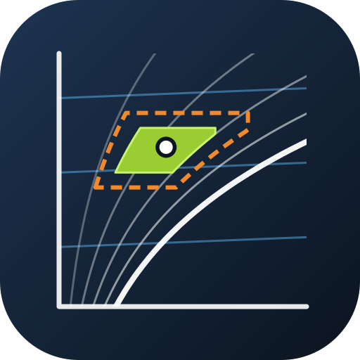

<p align="center">
  
</p>

<h1 align="center">Mollier hx Card</h1>

<p align="center">
  A psychrometric h,x diagram for your Home Assistant dashboard,<br>
  with comfort zone, warning bands and a comfort compass.
</p>

<p align="center">
  <a href="https://github.com/retomarek/mollier-hx-card/releases"></a>
  <a href="https://github.com/hacs/integration"></a>
  
  <a href="https://github.com/retomarek/mollier-hx-card/actions/workflows/validate.yaml"></a>
  <a href="https://github.com/retomarek/mollier-hx-card/releases"></a>
  <a href="LICENSE"></a>
</p>

<p align="center">
  <a href="https://my.home-assistant.io/redirect/hacs_repository/?owner=retomarek&repository=mollier-hx-card&category=plugin"></a>
</p>

<p align="center">
  
  
</p>

Plot your room climate where it belongs: on a Mollier h,x diagram. The card reads the daily means of a temperature and a humidity sensor from Home Assistant's long-term statistics and plots one point per day. Draw your comfort zone, add orange and red warning bands around it, and the comfort compass sums up how many days were in range, too warm, too humid, too dry or too cold, and how far off they were.

## Features

- **Full h,x diagram** with iso-lines for temperature, relative humidity, density and enthalpy, for your altitude or air pressure.
- **One point per day** from the recorder's long-term statistics, coloured by season, by age or connected in time order, plus a live point for the current reading.
- **Comfort zone** as a polygon from temperature, relative and absolute humidity limits.
- **Warning bands**: orange and red dashed bands as ± offsets around the comfort zone.
- **Comfort compass**: an area-true glyph that splits the days into *in range* and eight directions (warm, humid, dry, cold and their mixes), graded mild / moderate / severe by the warning bands. Hover or tap a segment for the details.
- **Visual editor** with entity pickers limited to sensors that have long-term statistics.
- **Translated**: English and German, following your Home Assistant language. More languages are welcome, see [Translations](#translations).
- **Self-contained**: one JavaScript file, no external requests at runtime.

## Requirements

Both sensors need long-term statistics, which means `state_class: measurement`. Most temperature and humidity sensors already have it (Zigbee, Z-Wave, ESPHome, Netatmo, AirGradient and many more). The visual editor only lists sensors that qualify.

## Installation

### Marketplace or HACS (recommended)

From Home Assistant 2026.11 on, community cards come from the built-in **Marketplace** (*Settings → Marketplace*). On older versions use **HACS**. Both use the same catalog.

1. Open the link above, or search for **Mollier hx Card**.
   - Not listed yet? Marketplace: *Add from link* with `https://github.com/retomarek/mollier-hx-card`. HACS: three-dot menu → *Custom repositories*, type *Dashboard*.
2. Install it. The dashboard resource is added for you.
3. Reload the browser.

> **Switching from a manual install?** Remove the old resource (for example `/local/mollier-hx-card.js`) under *Settings → Dashboards → Resources* and delete the old file first. If both copies load, the browser rejects the second one and the card shows an error.

### Manual

1. Download `mollier-hx-card.js` from the [latest release](https://github.com/retomarek/mollier-hx-card/releases) into `<config>/www/`.
2. Add it under *Settings → Dashboards → three-dot menu → Resources*: URL `/local/mollier-hx-card.js`, type **JavaScript module**.
3. Reload the browser.

## Configuration

Add a card, pick **Mollier hx card** and fill in the form. Or use YAML:

```yaml
type: custom:mollier-hx-card
temperature_entity: sensor.living_room_temperature
humidity_entity: sensor.living_room_humidity
header: Living room
days: 120
altitude: 450
comfort_zone:
  temperature: [20, 26]
  humidity: [30, 60]
  absolute_humidity: [0, 12]
warning_bands: true
show_compass: true
```

### Options

| Option | Type | Default | Description |
| --- | --- | --- | --- |
| `temperature_entity` | string | | **Required.** Temperature sensor. |
| `humidity_entity` | string | | **Required.** Relative-humidity sensor. Values in 0..1 or 0..100 are detected. |
| `header` | string | | Card title. |
| `days` | number | `7` | Days of history. The recorder keeps long-term statistics for a year by default. |
| `coloring` | string | `season` | `season`, `age` (older days fade) or `chronological` (days joined by a line). |
| `altitude` | number | | Altitude in m above sea level. Sets the air pressure from the standard atmosphere and overrides `pressure`. |
| `pressure` | number | `101325` | Air pressure in Pa. |
| `convention` | string | `classical` | `classical` (per kg dry air, Recknagel) or `glueck` (per kg moist air). Same physics, slightly different tilt of the isotherms. |
| `domain_x` | `[min, max]` | `[0, 20]` | Absolute-humidity axis in g/kg. |
| `domain_y` | `[min, max]` | `[-20, 50]` | Temperature axis in °C. |
| `comfort_zone` | object | | Comfort zone, see below. |
| `warning_bands` | `true` or object | | Needs `comfort_zone`. `true` uses the defaults, see below. |
| `show_compass` | boolean | `false` | Needs `comfort_zone`. Shows the comfort compass below the diagram. |
| `compass_scale` | string | `fit` | `fit` zooms the compass to its glyph. `fixed` keeps the dashed 100 % circle the same size in every card, so you can compare rooms side by side. |

#### `comfort_zone`

```yaml
comfort_zone:
  temperature: [20, 26]        # °C
  humidity: [30, 60]           # % relative humidity
  absolute_humidity: [0, 12]   # g/kg
```

All three ranges are required. The zone is where all three hold; use `absolute_humidity: [0, 1000]` to leave that limit open.

#### `warning_bands`

Each band is a **± offset around the comfort zone**: temperature in K, relative humidity in %-points, absolute humidity in g/kg.

```yaml
warning_bands:
  orange: { temperature: 1, humidity: 5, absolute_humidity: 1 }
  red: { temperature: 2.5, humidity: 10, absolute_humidity: 2.5, label: Alarm }
```

| Band | `temperature` | `humidity` | `absolute_humidity` | `color` |
| --- | --- | --- | --- | --- |
| `orange` | 1 | 5 | 1 | `#E67E22` |
| `red` | 2.5 | 10 | 2.5 | `#C0392B` |

These are the defaults. `label` and `color` are optional per band.

### Comfort compass

The compass counts days, using the same daily means as the diagram. Each day is compared with the comfort zone. Humidity counts as too high or too low when **either** the relative or the absolute limit is exceeded. The warning bands set the severity: *mild* is inside the orange band, *moderate* inside the red band, *severe* beyond it. The worse of temperature and humidity decides.

The glyph is area-true. The green disc's area is the share of days in range, and each wedge's area is the share of days off in that direction. Warm is at the top, cold at the bottom, humid on the right and dry on the left, the same as in the h,x diagram.

## Translations

The card uses the language of your Home Assistant profile and falls back to English for anything not translated. Available: English, German.

To add a language, copy [`src/localize/languages/en.json`](src/localize/languages/en.json) to `<language code>.json`, translate the values, register it in [`src/localize/localize.js`](src/localize/localize.js) and open a pull request. See [CONTRIBUTING.md](CONTRIBUTING.md).

## How it works

The diagram math and D3 drawing code come from [pyedautils](https://github.com/retomarek/pyedautils) (`data/d3_mollierhx`), so the card draws the same diagram as `pyedautils.plots.plot_mollier_hx()`. The comfort compass is a port of `pyedautils.comfort.comfort_compass_distribution` and `plot_comfort_compass`. Daily means come from Home Assistant's `recorder/statistics_during_period` WebSocket API.

## Credits

- [pyedautils](https://github.com/retomarek/pyedautils): diagram math, D3 drawing code, warning bands and comfort compass.
- Thermodynamic relations from chapters 2.1 and 2.2 of *Glück: Zustands- und Stoffwerte – Wasser – Dampf – Luft*.

## License

[MIT](LICENSE)
